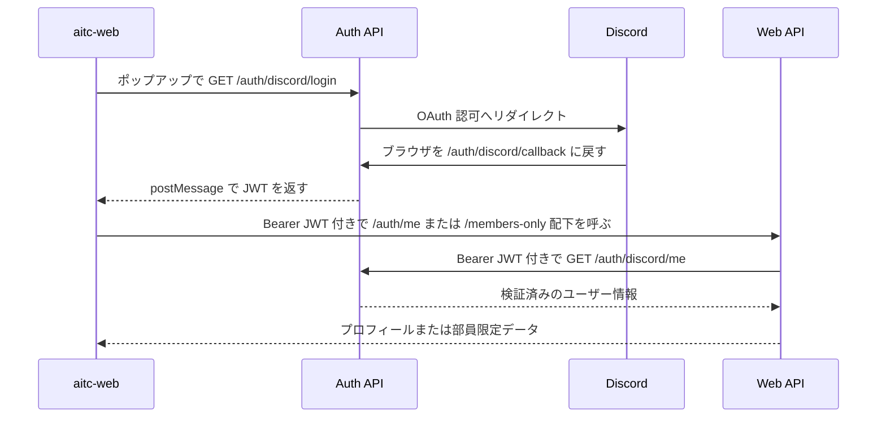

# Discord 認証アーキテクチャ



ポップアップからのメッセージは、`NEXT_PUBLIC_AUTH_BASE_URL` の Origin、開いたウィンドウ、ログイン試行 ID が一致する場合に受け付けます。
JWT は `localStorage` に保存し、タブやブラウザを閉じても **JWTの発行から1時間** までは認証を復元します。
復元時にも Web API の `/auth/me` で確認し、`401` または `403` が返った場合はトークンを消去してログイン画面に戻します。

ログアウトや認証失効時は両 `localStorage` から消去し、`storage` イベントで開いている他のタブもログアウトします。

公開コンテンツと部員限定データの URL は `NEXT_PUBLIC_API_BASE_URL` で指定します。
部員限定メンバープロフィールは `/members-only/members/profile?id=<member-id>` で開きます。
> ※ aitc-web-infra の openapi.yaml 参照

## 開発環境での確認

リポジトリのルートの `.env.local` に、各 dev スタックの出力 URL を設定します。

```dotenv
NEXT_PUBLIC_AUTH_BASE_URL=<Auth API の AuthBaseUrl>
NEXT_PUBLIC_API_BASE_URL=<Web API の HttpApiEndpoint>
```

```sh
npm run dev:oauth
```

### 確認事項

- [ ] `http://localhost:5173/members-only` を開き、Discord ログイン後に Web API の `/auth/me` と部員限定 API が成功することを確認する
  > ※ `aitc-auth-api` の dev スタック出力 `DiscordRedirectUri` は Discord Developer Portal の OAuth2 Redirects に登録します。
- [ ] ログイン後、タブやブラウザを閉じて同じ URL を開き直し、有効期限内なら再ログインせずに復元できることを確認する
- [ ] 部員限定ページを2つのタブで開き、一方でログアウトすると他方もログイン画面に戻ることを確認する
  > ※ 有効期限切れの JWT は Web API の拒否後に削除され、再ログインが必要になります。

## 本番公開

GitHub Pages のビルドではそれぞれの API の URL に以下を指定します。

- Auth API : `https://auth.a-i-t-c.com`
- Web API : `https://api.a-i-t-c.com`

Web API の更新に続けてフロントを公開すると、旧 HS256 JWT を保持していた利用者は再ログインが必要になります。
`main` への push は Pages の公開を開始します。

[Web API の本番切り替え手順](https://github.com/A-ITC/aitc-web-infra/blob/502f79c8bf0532f519b00ccce9a21da54f3b7004/docs/oauth-authentication.md#本番切り替え)
