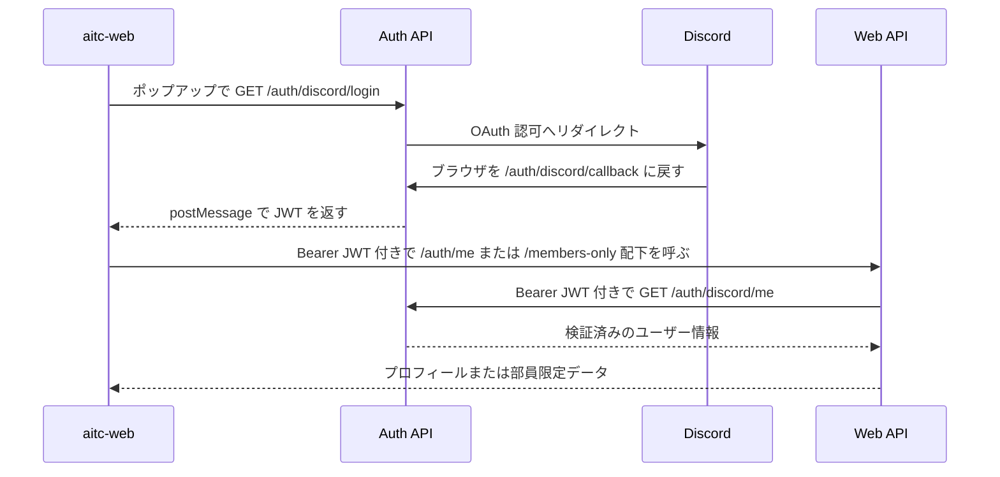

# Discord ログインと部員限定 API



ポップアップからのメッセージは、`NEXT_PUBLIC_AUTH_BASE_URL` の Origin、開いたウィンドウ、ログイン試行 ID が一致する場合に受け付けます。JWT はタブの `sessionStorage` に保存します。Web API が `401` または `403` を返した場合、プロフィール取得時にトークンを消去してログイン画面に戻します。

公開コンテンツと部員限定データの URL は `NEXT_PUBLIC_API_BASE_URL` で指定します。部員限定メンバープロフィールは `/members-only/members/profile?id=<member-id>` で開きます。[Web API の OpenAPI](./openapi.yaml)

## 開発環境での確認

リポジトリのルートの `.env.local` に、各 dev スタックの出力 URL を設定します。

```dotenv
NEXT_PUBLIC_AUTH_BASE_URL=<Auth API の AuthBaseUrl>
NEXT_PUBLIC_API_BASE_URL=<Web API の HttpApiEndpoint>
```

```sh
npm run dev:oauth
```

`http://localhost:5173/members-only` を開き、Discord ログイン後に Web API の `/auth/me` と部員限定 API が成功することを確認します。Auth API の dev スタック出力 `DiscordRedirectUri` は Discord Developer Portal の OAuth2 Redirects に登録します。

## 本番公開

GitHub Pages のビルドでは Auth API に `https://auth.a-i-t-c.com`、Web API に `https://api.a-i-t-c.com` を設定します。Web API の更新に続けてフロントを公開すると、旧 HS256 JWT を保持していた利用者は再ログインが必要になります。`main` への push は Pages の公開を開始します。[Web API の本番切り替え手順](https://github.com/A-ITC/aitc-web-infra/blob/502f79c8bf0532f519b00ccce9a21da54f3b7004/docs/oauth-authentication.md#本番切り替え)
